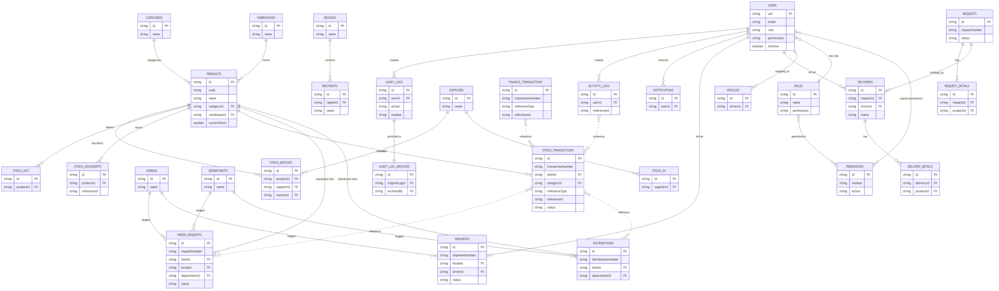

# ERD — LOGITRACK / SILOG

Dokumen ini memetakan model data Firestore (NoSQL) ke dalam **ERD logis** untuk keperluan ujikom. Relasi berikut adalah relasi *logical foreign key* berupa document ID / uid / `referenceType` + `referenceId`, **bukan** foreign key fisik seperti pada RDBMS.

## Diagram ERD (Mermaid)

```mermaid
erDiagram
    USERS {
        string uid PK "Firebase Auth UID = document ID"
        string email
        string displayName
        string role
        string[] permissions
        boolean isActive
    }
    ROLES {
        string id PK
        string name
        string[] permissions
        boolean isActive
    }
    PERMISSIONS {
        string id PK
        string module
        string action
        string name
    }
    AUDIT_LOGS {
        string id PK
        string userId FK
        string action
        string module
        string description
        timestamp createdAt
    }
    AUDIT_LOG_ARCHIVES {
        string id PK
        string originalLogId FK
        string archivedBy FK
        timestamp archivedAt
        string archiveReason
    }
    PRODUCTS {
        string id PK
        string code
        string name
        string categoryId FK
        string warehouseId FK
        number currentStock "source of truth stok"
        number minStock
        string itemStatus
    }
    CATEGORIES {
        string id PK
        string name
        boolean isActive
    }
    WAREHOUSES {
        string id PK
        string name
    }
    SUPPLIERS {
        string id PK
        string name
        string contactPerson
    }
    KORDAS {
        string id PK
        string name
        boolean isActive
    }
    DEPARTMENTS {
        string id PK
        string name
        boolean isActive
    }
    NEEDS_REQUESTS {
        string id PK
        string requestNumber
        string itemId FK
        string categoryId FK
        string kordaId FK
        string departmentId FK
        string status
        string approvedBy FK
    }
    SHIPMENTS {
        string id PK
        string shipmentNumber
        string kordaId FK
        string driverId FK
        string status
        string[] proofPhotos
    }
    STOCK_TRANSACTIONS {
        string id PK
        string transactionNumber
        string itemId FK
        string categoryId FK
        string kordaId FK
        string warehouseId FK
        string type
        number previousStock
        number newStock
        string referenceType
        string referenceId
        string status
    }
    DISTRIBUTIONS {
        string id PK
        string distributionNumber
        string itemId FK
        string departmentId FK
        string kordaId FK
    }
    FINANCE_TRANSACTIONS {
        string id PK
        string transactionNumber
        string type
        number amount
        string referenceType
        string referenceId
    }
    REGIONS {
        string id PK
        string name
        string rtNumber
    }
    RECIPIENTS {
        string id PK
        string regionId FK
        string name
    }
    ACTIVITY_LOGS {
        string id PK
        string userId FK
        string referenceId
        string action
    }
    NOTIFICATIONS {
        string id PK
        string userId FK
    }
    STOCK_BATCHES {
        string id PK
        string productId FK
        string supplierId FK
        string stockInId FK
        number quantity
    }
    STOCK_IN {
        string id PK
        string invoiceNumber
        string supplierId FK
    }
    STOCK_OUT {
        string id PK
        string productId FK
        number quantity
    }
    REQUESTS {
        string id PK
        string requestNumber
        string status
    }
    REQUEST_DETAILS {
        string id PK
        string requestId FK
        string productId FK
        number requestedQty
    }
    DELIVERIES {
        string id PK
        string deliveryNumber
        string requestId FK
        string driverId FK
        string status
    }
    DELIVERY_DETAILS {
        string id PK
        string deliveryId FK
        string productId FK
        number quantity
    }
    VEHICLES {
        string id PK
        string plateNumber
        string driverId FK
    }
    STOCK_MOVEMENTS {
        string id PK
        string productId FK
        string referenceId
        string type
    }

    USERS ||--o{ AUDIT_LOGS : creates
    USERS ||--o{ ACTIVITY_LOGS : creates
    USERS ||--o{ NOTIFICATIONS : receives
    USERS ||--o{ SHIPMENTS : drives
    USERS ||--o{ DELIVERIES : drives
    USERS ||--o{ VEHICLES : assigned_to
    USERS }o--|| ROLES : "role (nama)"
    ROLES }o--o{ PERMISSIONS : "permissions[]"
    USERS }o--o{ PERMISSIONS : "copied permissions[]"

    CATEGORIES ||--o{ PRODUCTS : categorizes
    WAREHOUSES ||--o{ PRODUCTS : stores
    PRODUCTS ||--o{ STOCK_BATCHES : "has batch"
    SUPPLIERS ||--o{ STOCK_BATCHES : supplies
    SUPPLIERS ||--o{ STOCK_IN : supplies
    PRODUCTS ||--o{ STOCK_OUT : leaves
    PRODUCTS ||--o{ STOCK_MOVEMENTS : moves
    PRODUCTS ||--o{ STOCK_TRANSACTIONS : mutates
    PRODUCTS ||--o{ NEEDS_REQUESTS : "requested item"
    PRODUCTS ||--o{ DISTRIBUTIONS : "distributed item"

    KORDAS ||--o{ NEEDS_REQUESTS : targets
    DEPARTMENTS ||--o{ NEEDS_REQUESTS : targets
    KORDAS ||--o{ SHIPMENTS : targets
    DEPARTMENTS ||--o{ DISTRIBUTIONS : targets
    REGIONS ||--o{ RECIPIENTS : contains

    REQUESTS ||--o{ REQUEST_DETAILS : has
    REQUESTS ||--o{ DELIVERIES : fulfilled_by
    DELIVERIES ||--o{ DELIVERY_DETAILS : has

    AUDIT_LOGS ||--|| AUDIT_LOG_ARCHIVES : "archived to (originalLogId)"
    STOCK_TRANSACTIONS }o..o{ NEEDS_REQUESTS : "referenceType + referenceId"
    STOCK_TRANSACTIONS }o..o{ DISTRIBUTIONS : "referenceType + referenceId"
    FINANCE_TRANSACTIONS }o..o{ STOCK_TRANSACTIONS : "referenceType + referenceId"
    ACTIVITY_LOGS }o..o{ STOCK_TRANSACTIONS : "referenceId"
```

## Catatan penting

1. **Entitas tunggal inventaris:** tidak ada koleksi `items`. Koleksi `products` adalah master barang satu-satunya; permission `items.*` hanyalah ID permission, bukan koleksi tersendiri.
2. **Sumber stok tunggal:** `products.currentStock`. Setiap mutasi wajib tercatat di `stockTransactions` melalui Firestore transaction; saldo negatif ditolak. Koleksi lama (`stock_batches`, `stock_movements`, `stock_in`, `stock_out`, `requests`, `deliveries`) dipertahankan untuk kompatibilitas dan alurnya ikut menulis `stockTransactions`.
3. **Relasi polimorfik:** `stockTransactions` dan `financeTransactions` memakai pasangan `referenceType` + `referenceId` untuk merujuk ke dokumen dari koleksi berbeda. Firestore tidak memiliki constraint FK fisik.
4. **Field denormalisasi:** `categoryName`, `itemName`, `productName`, `supplierName`, `warehouseName`, `kordaName`, `departmentName`, `driverName`, `userName`, dan sejenisnya adalah salinan teks untuk tampilan. Entitas kanoniknya tetap tabel/koleksi induknya.
5. **Arsip audit:** backend Admin SDK menyalin `audit_logs` ke `audit_log_archives` dengan ID dokumen sama, menambahkan `originalLogId`, `archivedAt`, `archivedBy`, `archiveReason`, lalu menghapus log asal dan menulis event audit baru `ARCHIVE_AUDIT_LOGS`.
6. **Identitas:** document ID `users` sama dengan Firebase Auth UID. UID ini dipakai ulang di `createdBy`, `updatedBy`, `approvedBy`, `userId`, `driverId`, dan `archivedBy`.

## Relasi ringkas (tabel)

| Dari | Field | Ke | Kardinalitas | Keterangan |
| --- | --- | --- | --- | --- |
| `users` | `uid` | Firebase Auth | 1:1 | Eksplisit |
| `users` | `role` | `roles.name` | N:1 | Berdasarkan nama role |
| `roles` | `permissions[]` | `permissions.id` | N:M | Eksplisit |
| `products` | `categoryId` | `categories.id` | N:1 | Eksplisit |
| `products` | `warehouseId` | `warehouses.id` | N:1 | Inferred |
| `stockTransactions` | `itemId` | `products.id` | N:1 | Eksplisit, menulis balik saldo |
| `needsRequests` | `itemId`, `kordaId`, `departmentId` | `products`, `kordas`, `departments` | N:1 | Eksplisit |
| `shipments` | `driverId`, `kordaId` | `users.uid`, `kordas.id` | N:1 | Driver hanya lihat milik sendiri |
| `distributions` | `itemId`, `departmentId` | `products`, `departments` | N:1 | Eksplisit |
| `recipients` | `regionId` | `regions.id` | N:1 | Inferred |
| `audit_logs` | `originalLogId` via arsip | `audit_log_archives` | 1:1 | Eksplisit via backend |
| `stockTransactions` | `referenceType + referenceId` | koleksi mana pun | N:1 opsional | Polimorfik |
