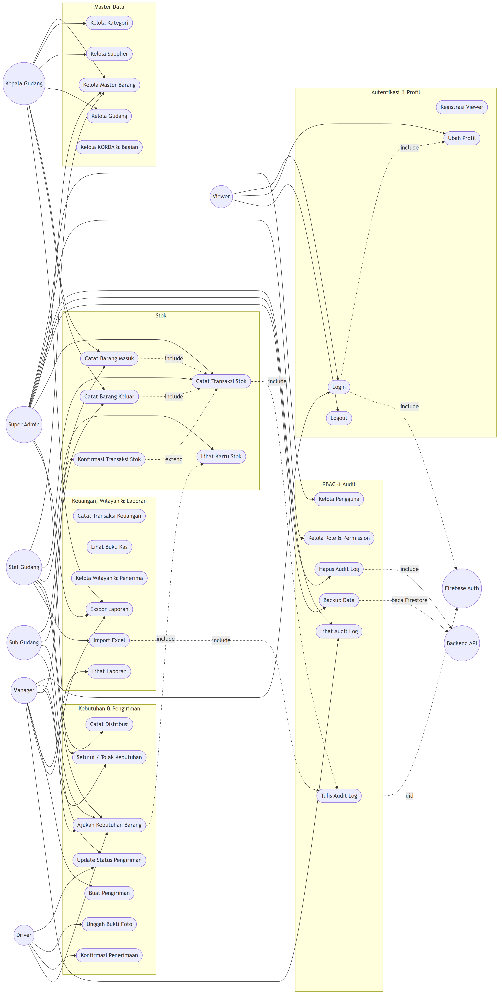
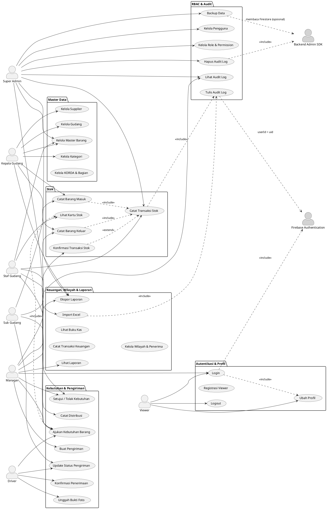

# USE CASE — LOGITRACK / SILOG

Dokumen ini menjelaskan perilaku sistem dari sudut pandang aktor. Use case diturunkan dari permission di `src/services/rbacService.ts`, rute di `src/App.tsx`, dan aturan di `firestore.rules`.

## 1. Aktor

| Aktor | Alias | Keterangan |
| --- | --- | --- |
| Super Admin | `SA` | Akses penuh, termasuk RBAC, audit log, backup data |
| Manager | `M` | Approval kebutuhan/transaksi, monitoring, laporan |
| Kepala Gudang | `KG` | Mengawasi master data, stok, barang masuk/keluar |
| Staf Gudang | `SG` | Mutasi stok, distribusi, master barang |
| Sub Gudang | `SUB` | Staf Bahan Dapur, Konsumsi, Sayuran, Bumbu Alam, Logistik, Kebersihan (akses sesuai preset) |
| Driver | `D` | Tugas pengiriman yang ditugaskan kepadanya |
| Viewer | `V` | Akses terbatas, umumnya hanya pengaturan/profil |
| Firebase Authentication | `AUTH` | Actor sekunder: login, token, identitas |
| Backend Admin SDK | `API` | Actor sekunder: operasi audit log, laporan ringkasan |

## 2. Diagram Use Case (PlantUML)

## 3. Daftar use case ringkas

| ID | Use Case | Aktor utama | Permission / rute |
| --- | --- | --- | --- |
| UC-01 | Login | Semua | `/login`, Firebase Auth |
| UC-02 | Registrasi Viewer | Viewer | `authService.registerUser` |
| UC-03 | Kelola Pengguna | Super Admin | `users.*`, `/users` |
| UC-04 | Kelola Role & Permission | Super Admin | `roles.*`, `/roles` |
| UC-05 | Lihat / Hapus Audit Log | Super Admin | `/audit-logs`, `POST /api/audit-logs/delete` |
| UC-06 | Backup Data | Super Admin / pemilik `backup.export` | `/backup` |
| UC-07 | Kelola Master Barang | KG, SG | `products.*` / `items.*`, `/products` |
| UC-08 | Kelola Kategori & Supplier | KG | `categories.*`, `suppliers.*` |
| UC-09 | Barang Masuk / Keluar | KG, SG, SUB | `stock_in.*`, `stock_out.*` |
| UC-10 | Catat & Konfirmasi Transaksi Stok | SG, M | `stockTransactions.*`, `/stock-control` |
| UC-11 | Ajukan Kebutuhan | SG, SUB, M, D | `needsRequests.create`, `/needs` |
| UC-12 | Setujui / Tolak Kebutuhan | Manager, SA | `needsRequests.approve/reject` |
| UC-13 | Catat Distribusi | SG | `distributions.create` |
| UC-14 | Buat & Monitor Pengiriman | M, SG, D | `shipments.*`, `/shipments` |
| UC-15 | Update Status & Upload Bukti | Driver | `shipments.confirm/upload`, aturan `driverId == uid` |
| UC-16 | Catat / Lihat Keuangan | SA/custom | `finance.*`, `/finance` |
| UC-17 | Kelola Wilayah & Penerima | SA/custom | `regions.*`, `/regions` |
| UC-18 | Lihat & Ekspor Laporan | M, KG, SA | `reports.view/export`, `/reports-advanced` |
| UC-19 | Import Excel | SG/custom | `imports.execute`, komponen `ExcelImport` |

## 4. Spesifikasi use case prioritas

### UC-10 — Catat & Konfirmasi Transaksi Stok
- **Aktor:** Staf Gudang (catat), Manager/Super Admin (konfirmasi).
- **Precondition:** pengguna aktif memiliki `stockTransactions.create` atau `stock_in/out.create`; barang `products` tersedia.
- **Alur utama:** pilih barang → isi tipe `IN/OUT/ADJUSTMENT/OPNAME`, quantity, satuan → sistem simpan `stockTransactions` dengan status `Draft` → approver membuka transaksi → konfirmasi.
- **Aturan domain:** konfirmasi memakai Firestore transaction; baca `products.currentStock`; tolak jika `unit` berbeda atau status bukan `Draft`; hitung `delta`; tolak saldo negatif; update `previousStock`, `newStock`, `approvedBy`, `approvedAt`, lalu `products.currentStock`.
- **Postcondition:** saldo produk berubah sekali dan audit/event tercatat.

### UC-11/12 — Ajukan & Setujui Kebutuhan
- **Aktor:** Staf/Sub Gudang mengajukan; Manager menyetujui atau menolak.
- **Alur:** buat `needsRequests` status `Pending` dengan `createdBy = uid` → Manager memilih setujui/tolak → status berubah `Approved`/`Rejected`, `approvedBy` dan `approvedAt` diisi.
- **Exception:** edit hanya saat status masih `Pending` dan oleh pembuatnya.

### UC-15 — Update Pengiriman oleh Driver
- **Aktor:** Driver.
- **Precondition:** `shipments.driverId == auth.uid` atau `deliveries.driverId == auth.uid`.
- **Alur:** lihat daftar tugas → ubah status → unggah bukti foto ke Firebase Storage → simpan `proofPhotos`/`proofImageUrl`.
- **Aturan domain:** rules membatasi driver hanya pada pengiriman yang ditugaskan; field yang boleh diubah dibatasi.

### UC-05 — Hapus Audit Log
- **Aktor:** Super Admin.
- **Precondition:** login sebagai Super Admin; log berasal dari Firestore (bukan log lokal yang belum tersinkron).
- **Alur:** pilih satu/beberapa log → konfirmasi → frontend POST ke `/api/audit-logs/delete` → backend verifikasi token + role → Admin SDK menghapus dokumen di transaction.
- **Exception:** 400 jika ID tidak valid, 401 sesi invalid, 403 bukan Super Admin, 409 log tidak ditemukan, 429 terlalu banyak permintaan.

### UC-06 — Backup Data
- **Aktor:** Super Admin atau user dengan permission `backup.export`.
- **Alur:** buka `/backup` → sistem menampilkan ringkasan 29 koleksi → pilih **Unduh Excel** atau **Unduh PDF** → front-end membaca ulang data → file terunduh dengan nama `backup-silog-YYYY-MM-DD.xlsx/pdf`.
- **Postcondition:** file backup berisi data Firestore yang berhasil dibaca; koleksi yang gagal ditandai pada ringkasan.

## 5. Catatan

- Diagram di atas adalah representasi; implementasi aktual memakai Firestore rules dan permission IDs, bukan use case framework khusus.
- Beberapa permission (misalnya `finance.view`, `regions.manage`, `kordas.manage`) tidak ada di preset role sistem, sehingga secara praktis hanya Super Admin atau role kustom yang memilikinya.
- `shipments.confirm` juga tersedia untuk Driver pada preset; pastikan konteks ujikom menyebut pembatasan `driverId == uid` sebagai aturan keamanan yang diharapkan.
